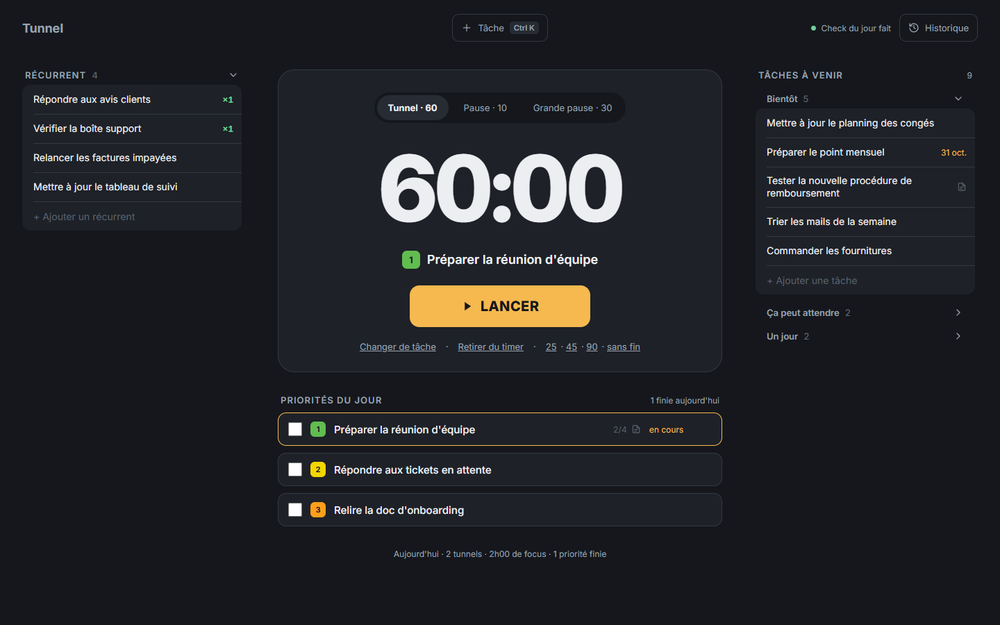
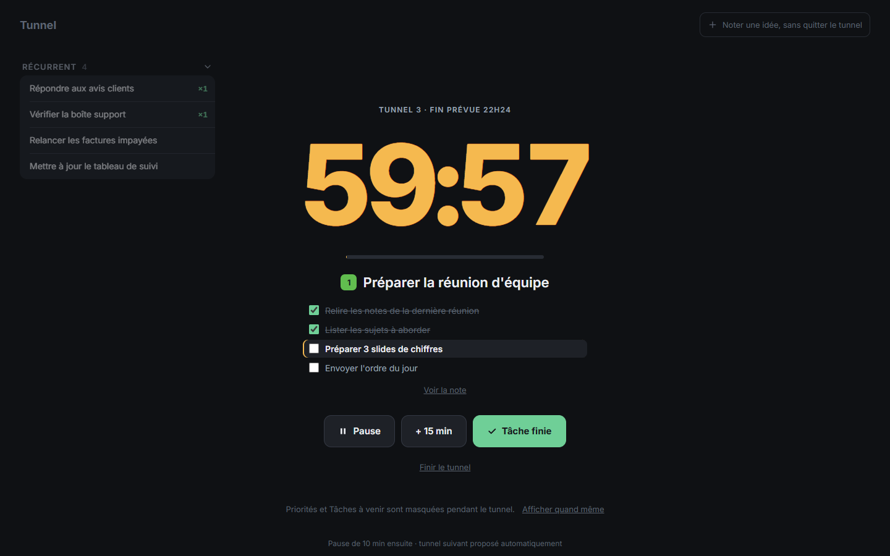
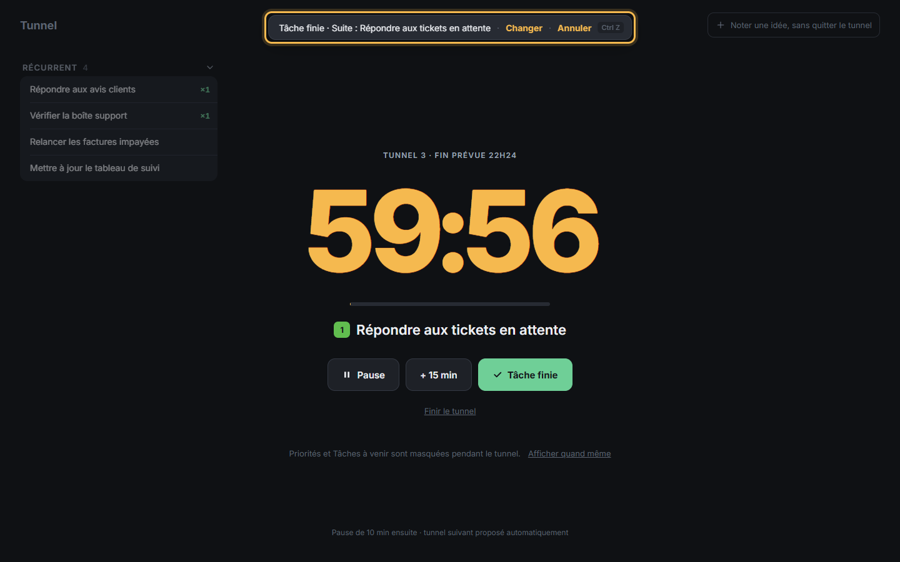
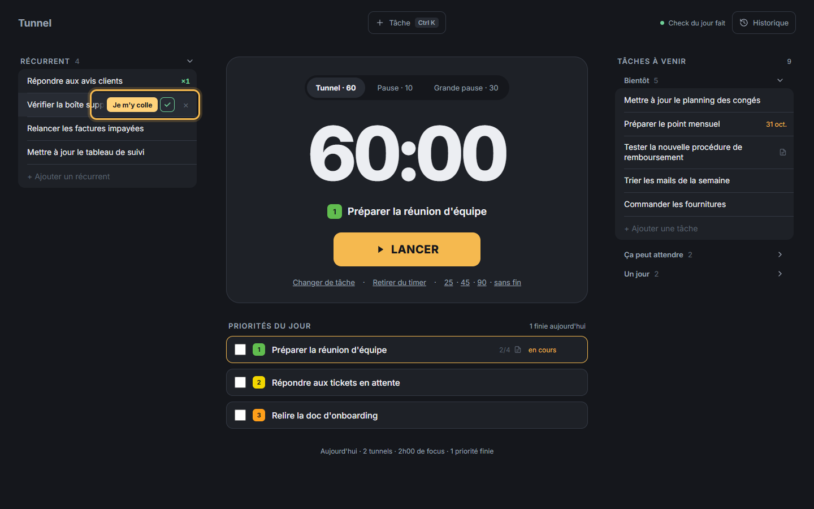
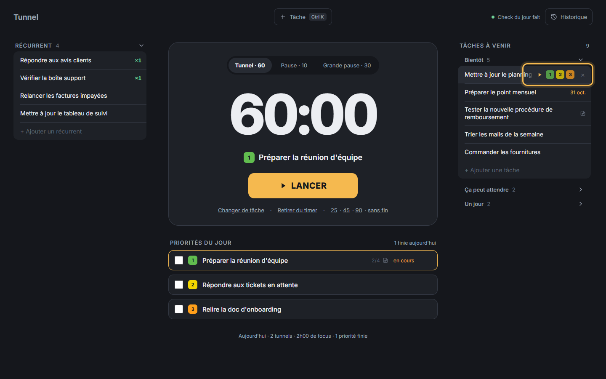
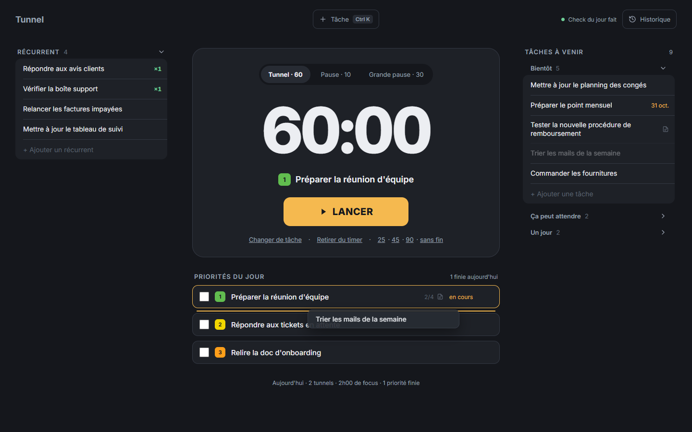
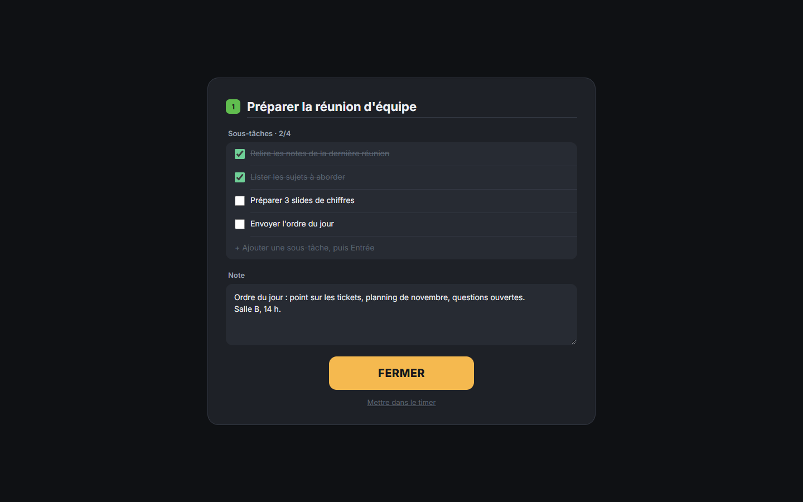
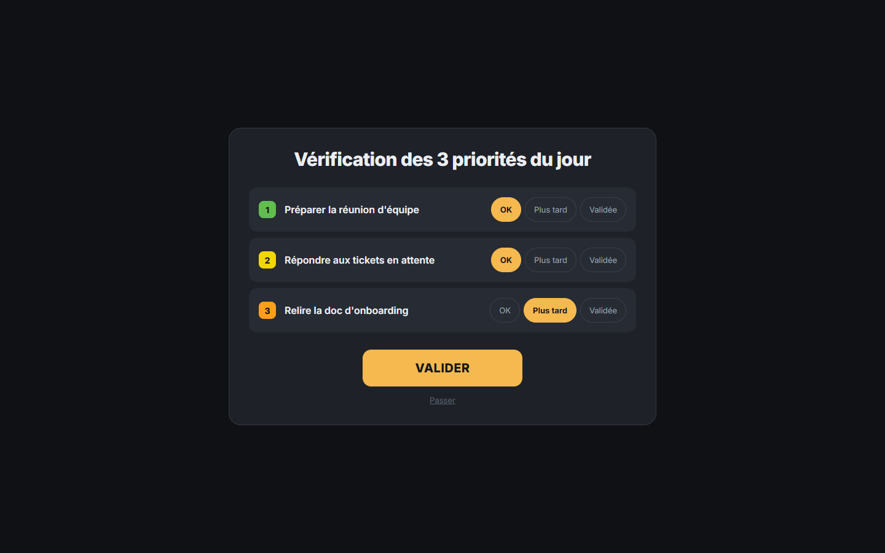
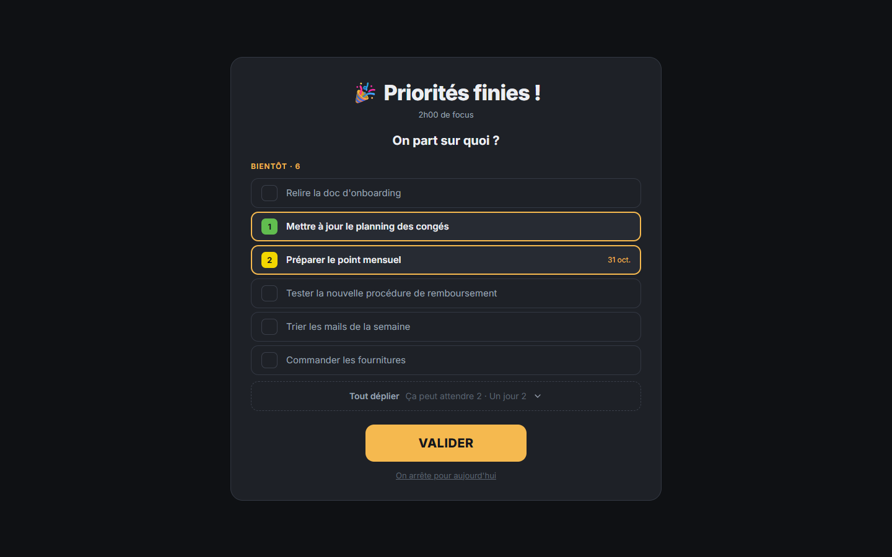
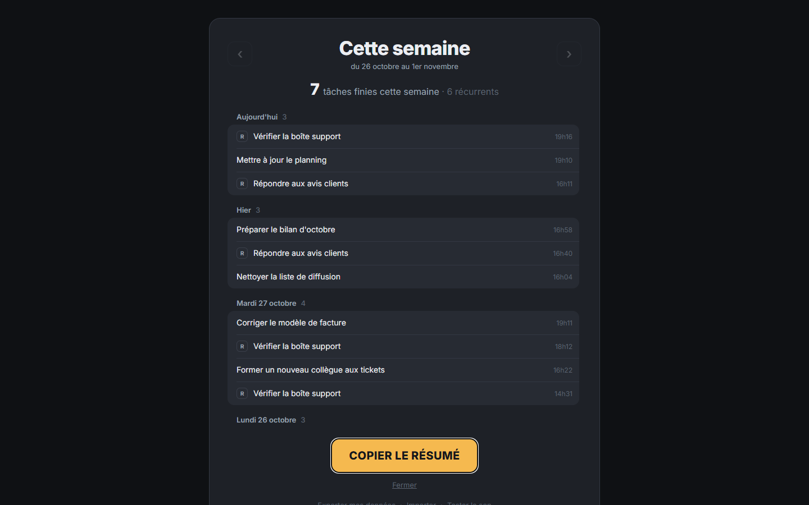

# Tunnel

Tunnel t'aide à rester concentré longtemps sur une seule chose, puis à enchaîner sur la suivante sans te perdre.
Tu choisis 3 priorités pour la journée, tu lances un « tunnel » (un minuteur de concentration), et l'app s'occupe du reste : la suite, les pauses, les petites tâches qui reviennent.
Elle est pensée pour les cerveaux qui décrochent vite : un seul écran, peu de choix, tout s'annule d'un Ctrl+Z.



**Sommaire** : [Installer](#installer) · [Prise en main](#prise-en-main) · [Raccourcis](#raccourcis-clavier) · [Tes données](#tes-données) · [Mises à jour](#mises-à-jour) · [Questions fréquentes](#questions-fréquentes)

---

## Installer

### Sur Mac

**[Télécharger Tunnel pour Mac (.dmg)](https://github.com/DweEroz/tunnel-releases/releases/download/v2.0.0/Tunnel_2.0.0_universal.dmg)**

Ça marche sur tous les Mac récents, Intel comme Apple (M1, M2, M3, M4…).

Sur Mac, c'est la version 2.0.0 : c'est normal. La version suivante arrivera toute seule, avec le bandeau « Mise à jour disponible » (voir [Mises à jour](#mises-à-jour)). Tu n'auras rien à retélécharger.

**1. Installer**

1. Double-clique le fichier `Tunnel_2.0.0_universal.dmg` téléchargé. Une fenêtre s'ouvre.
2. Fais glisser l'icône **Tunnel** sur le dossier **Applications**.
3. Ferme la fenêtre, puis éjecte le disque « Tunnel » dans le Finder (bouton ⏏ à côté de son nom).

**2. Première ouverture**

Tunnel ne vient pas de l'App Store, alors ton Mac le bloque la première fois. Tu l'autorises **une seule fois**, ensuite il s'ouvre normalement.

1. Ouvre le dossier **Applications** et double-clique **Tunnel**.
2. Un message dit qu'Apple n'a pas pu vérifier l'app. Clique **Terminé**. Surtout pas « Placer dans la corbeille ».
3. Ouvre le menu  (en haut à gauche de l'écran), puis **Réglages Système…**
4. Dans la colonne de gauche, clique **Confidentialité et sécurité**.
5. Descends jusqu'à la rubrique **Sécurité**. Une ligne indique que « Tunnel » a été bloqué. Clique **Ouvrir quand même**.
6. Une fenêtre redemande confirmation : clique encore **Ouvrir quand même**.
7. Tape le mot de passe de ta session Mac (ou pose ton doigt sur Touch ID).

Tunnel s'ouvre. C'est fini.

**Si ça bloque encore (dernier recours)**

À faire seulement si le bouton « Ouvrir quand même » n'apparaît pas, ou si le Mac dit que l'app « est endommagée ».

1. Vérifie que Tunnel est bien dans **Applications** (étape 1 ci-dessus).
2. Ouvre l'app **Terminal** : appuie sur ⌘ + Espace, tape `Terminal`, puis Entrée.
3. Copie la ligne ci-dessous, colle-la dans la fenêtre du Terminal, puis appuie sur Entrée :

   ```
   xattr -dr com.apple.quarantine /Applications/Tunnel.app
   ```

   Rien ne s'affiche : c'est normal, ça veut dire que c'est bon.
4. Ferme le Terminal et ouvre Tunnel depuis **Applications**.

Cette ligne retire juste l'étiquette « téléchargé depuis Internet » que le Mac a posée sur Tunnel. Elle ne touche à rien d'autre.

### Sur Windows

**[Télécharger Tunnel pour Windows (.exe)](https://github.com/DweEroz/tunnel-releases/releases/download/v2.0.1/Tunnel_2.0.1_x64-setup.exe)**

1. Double-clique le fichier `Tunnel_2.0.1_x64-setup.exe` téléchargé.
2. Si Windows affiche « Windows a protégé votre ordinateur » : clique **Informations complémentaires**, puis **Exécuter quand même**. Ce message apparaît parce que Tunnel n'est pas encore connu de Microsoft.
3. Suis l'installation. Pas besoin d'être administrateur.
4. Ouvre **Tunnel** depuis le menu Démarrer.

---

## Prise en main

Au tout premier lancement, l'app est remplie de **cartes d'exemple** : chaque titre explique une fonction. Lis-les, essaie-les, puis clique **Supprimer les exemples** (sous les priorités) pour repartir de zéro.

### L'écran principal


Tout tient sur un écran :

- **Au centre, le minuteur.** Choisis « Tunnel » (60 min par défaut, ou 25, 45, 90, sans fin), « Pause » (10 min) ou « Grande pause » (30 min). La tâche affichée dessous est celle sur laquelle tu vas travailler.
- **Dessous, les priorités du jour.** 3 places maximum, numérotées 1, 2, 3. C'est ce qui compte vraiment aujourd'hui. Clique un titre pour le mettre dans le minuteur. Coche la case quand c'est fini : la priorité part, les suivantes remontent.
- **À droite, les tâches à venir**, rangées en 3 listes : « Bientôt », « Ça peut attendre » et « Un jour ». Seule « Bientôt » est ouverte ; clique sur les autres pour les déplier.
- **À gauche, les récurrents** : les petites tâches de 2-3 minutes qui reviennent tous les jours (répondre aux avis, vérifier une boîte mail…).

En bas, une ligne résume ta journée : tunnels faits, temps de concentration, priorités finies.

### Lancer un tunnel

Clique **LANCER**. L'écran se vide pour ne garder que l'essentiel.



- Le **chrono** décompte, avec une barre de progression.
- La **tâche en cours** est affichée dessous. Si elle a des étapes (sous-tâches), elles sont là aussi, cochables, la prochaine mise en avant.
- **Pause** arrête le chrono un moment. **+ 15 min** rallonge le tunnel.
- **Finir le tunnel** termine plus tôt : ton temps de concentration est quand même compté.
- Les priorités et les tâches à venir sont cachées pour ne pas te distraire. Le lien **Afficher quand même** les montre si besoin.
- Une idée te traverse la tête ? **Noter une idée, sans quitter le tunnel** (en haut à droite, ou Ctrl+K). Tu la rangeras à la fin du tunnel.

Quand le temps est écoulé, un son retentit et une notification s'affiche. Tunnel te propose alors la pause (une grande pause tous les 4 tunnels), puis le tunnel suivant.

### « Tâche finie » et l'enchaînement automatique

Tu as fini avant la fin du chrono ? Clique **Tâche finie**.



- Un petit « ting » confirme. Le chrono **continue**.
- Tunnel passe tout seul à la suite : la priorité suivante, ou la tâche que tu avais interrompue (voir « Je m'y colle » plus bas).
- Le message en haut indique la suite. **Changer** te laisse en choisir une autre. **Annuler** (ou Ctrl+Z) revient en arrière.
- S'il n'y a plus de priorité, Tunnel te propose les premières tâches de « Bientôt ».

### Les récurrents : « Je m'y colle » et ✓

Passe la souris sur un récurrent : deux boutons apparaissent.



- **✓** : tu viens de le faire. Le compteur « ×1, ×2… » du jour augmente. Le récurrent reste dans la liste pour la prochaine fois. Le compteur repart à zéro chaque matin.
- **Je m'y colle** : tu t'y mets maintenant. Hors tunnel, ça lance un tunnel dessus. Pendant un tunnel, ça change juste la tâche en cours, sans toucher au chrono.

L'astuce : tu es sur une priorité, un client écrit, tu fais **Je m'y colle** sur « Répondre aux avis clients ». Quand tu cliques **✓**, Tunnel te ramène tout seul sur ta priorité.

Pendant un tunnel, la colonne des récurrents reste visible à gauche, en plus discret.

### Ajouter une tâche

Trois façons, selon ce qui est le plus rapide pour toi :

- **Une place de priorité vide** : clique « + Ajouter une priorité », tape, Entrée.
- **En bas d'une liste** : clique « + Ajouter une tâche » (ou « + Ajouter un récurrent »), tape, Entrée. Le champ reste prêt pour enchaîner.
- **N'importe quand : Ctrl+K** (⌘K sur Mac), ou le bouton **+ Tâche** en haut. Tape le titre, puis choisis où la ranger.


Si les 3 priorités sont prises, Tunnel te demande laquelle remplacer. Celle qui sort n'est pas perdue : elle part en tête de « Bientôt ».

### Ranger : pastilles 1 2 3 et glisser-déposer

Passe la souris sur une tâche à venir :



- **▶** la met dans le minuteur.
- **1, 2 ou 3** la passe en priorité à ce rang. Les autres descendent d'un cran. S'il n'y a plus de place, la dernière part en tête de « Bientôt ».
- **×** la supprime (Ctrl+Z pour la récupérer).

Tu peux aussi **attraper une tâche avec la souris et la déposer** ailleurs : plus haut ou plus bas dans sa liste, dans une autre liste, ou sur une priorité. Un trait ambre montre où elle va atterrir.



Pour déposer en haut d'une liste repliée (« Ça peut attendre », « Un jour »), lâche la tâche sur son titre.

### La carte d'une tâche

Clique sur une tâche à venir (ou sur **…** au survol d'une priorité) pour ouvrir sa carte.



- Le **titre** se modifie directement.
- Les **sous-tâches** découpent un gros morceau en petites étapes. Tape, Entrée, la suivante. Quand tu coches la dernière, la tâche est finie.
- La **note** garde ce qu'il ne faut pas oublier : un lien, un contexte, une salle.

Dans les listes, « 2/4 » indique les étapes faites, et une petite icône signale une note.

### La vérification du matin

Chaque jour, à ta première ouverture, Tunnel te demande où en sont tes 3 priorités.



Pour chacune :

- **OK** : elle reste.
- **Plus tard** : elle repart en tête de « Bientôt ».
- **Validée** : c'est fait, elle part dans les tâches finies.

Si des places se libèrent, Tunnel te propose de les remplir avec tes tâches de « Bientôt » :


Pas le temps ? **Passer**. Tu peux la relancer plus tard avec « Check du jour », en haut à droite.

### « Priorités finies ! »

Quand tu as fini tes 3 priorités, Tunnel le fête et te demande la suite.



Coche jusqu'à 3 tâches pour en faire tes nouvelles priorités, puis **VALIDER**. Ou bien **On arrête pour aujourd'hui** : tu as le droit.

### L'historique de la semaine

Le bouton **Historique** (en haut à droite) montre tout ce que tu as fini cette semaine, jour par jour. Les récurrents sont marqués d'un « R ».



- Les flèches ‹ › (ou ← →) passent d'une semaine à l'autre.
- **Remettre dans Bientôt** fait revenir une tâche finie trop vite.
- **COPIER LE RÉSUMÉ** copie un texte prêt à coller dans un message à ton équipe, par exemple :

  ```
  Semaine du 26 octobre au 1er novembre 2026

  • Mettre à jour la page tarifs
  • Préparer le bilan d'octobre
  • Répondre aux avis clients ×3
  ```

### Exporter et importer

En bas de l'historique :


- **Exporter mes données** enregistre toutes tes tâches dans un fichier (`tunnel-AAAA-MM-JJ.json`). Tu choisis où le ranger.
- **Importer** recharge un fichier exporté. Tunnel demande confirmation, car ça **remplace** tout ce qu'il y a dans l'app.
- **Tester le son** joue les sons de fin de tunnel, de fin de pause et de tâche finie.

---

## Raccourcis clavier

Sur Mac, ⌘ (Cmd) marche à la place de Ctrl.

| Touche | Ce que ça fait |
| --- | --- |
| Ctrl+K | Ajouter une tâche (« On la met où ? »). Pendant un tunnel : noter une idée. |
| Ctrl+Z | Annuler la dernière action : suppression, tâche cochée, déplacement… |
| Entrée | Valider ce que tu tapes. |
| Échap | Annuler, fermer. |
| ← → | Dans l'historique : semaine précédente ou suivante. |
| Tab, puis Espace | Attraper une tâche au clavier. Les flèches la déplacent, Espace la pose, Échap annule. |

---

## Tes données

**Tes tâches restent sur ton ordinateur.** Rien n'est envoyé sur Internet, il n'y a pas de compte à créer.

Elles sont dans un seul fichier, `tunnel-state.json` :

- **Mac** : `~/Library/Application Support/me.eroz.tunnel/` (dans le Finder : menu **Aller** → **Aller au dossier…**, puis colle ce chemin).
- **Windows** : `%APPDATA%\me.eroz.tunnel\` (colle ce chemin dans la barre d'adresse de l'Explorateur).

**Sauvegarder** : de temps en temps, Historique → **Exporter mes données**. Garde le fichier où tu veux (cloud, clé USB…).

**Changer d'ordinateur** :

1. Sur l'ancien : Historique → **Exporter mes données**.
2. Envoie-toi le fichier, ou mets-le sur une clé.
3. Sur le nouveau : installe Tunnel, puis Historique → **Importer**, et choisis le fichier.

---

## Mises à jour

Tu n'as rien à faire. Tunnel vérifie tout seul s'il existe une nouvelle version, au démarrage puis toutes les 6 heures.

Quand il y en a une, un bandeau discret apparaît en bas : **Mise à jour disponible · Installer**. Clique **Installer** : Tunnel se met à jour et redémarre. Tes tâches ne bougent pas.

Le bandeau ne s'affiche jamais pendant un tunnel ou une pause, pour ne pas te couper.

---

## Questions fréquentes

**Je ne vois pas la notification de fin de tunnel.**
Au premier tunnel, Tunnel demande l'autorisation d'envoyer des notifications : il faut accepter. Si tu as refusé :
- Mac : Réglages Système → **Notifications** → **Tunnel** → active **Autoriser les notifications**.
- Windows : Paramètres → **Système** → **Notifications** → active **Tunnel**.

Vérifie aussi que le mode « Concentration » (Mac) ou « Ne pas déranger » (Windows) n'est pas activé.

**Je n'entends pas de son.**
Vérifie le volume de ton ordinateur. Clique une fois n'importe où dans Tunnel après l'avoir ouvert : le son se débloque au premier clic. Puis fais le test : Historique → **Tester le son**.

**J'ai supprimé (ou coché) une tâche par erreur.**
Fais **Ctrl+Z** (⌘Z sur Mac) tout de suite. Tu peux annuler plusieurs actions de suite. Le message en bas de l'écran propose aussi **Annuler** pendant quelques secondes.

**Je veux recommencer à zéro.**
1. Si tu veux garder une copie : Historique → **Exporter mes données**.
2. Quitte Tunnel (⌘Q sur Mac, ou ferme la fenêtre sur Windows).
3. Ouvre le dossier de tes données (voir [Tes données](#tes-données)) et supprime le fichier `tunnel-state.json`.
4. Rouvre Tunnel : il repart comme au premier jour, avec les cartes d'exemple.
